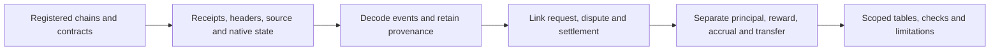

# Oracle4SD Atlas — oracle accountability evidence

This repository reconstructs how blockchain oracle requests are challenged, adjudicated and paid. It preserves the distinction between a protocol's decision, independent factual truth, money at risk, accrued entitlements and actual transfers.

**Review bundle:** `atlas-review-20260916`. **Runnable data version:** `uma-public-rpc-case-v1`. **Observation cutoff:** 2026-06-30 23:59:59 UTC. [Machine-readable identity](metadata/release.json).

The runnable example uses **real public evidence**: five transactions across Polygon and Ethereum reconstruct one UMA disputed request. Seven bundled inputs produce nine decoded protocol events, eight token transfers and one economic episode. The winning transfer of 1,000 USDC.e consists of 750 returned principal and 250 token gain. This does not establish external truth or total economic profit.

## Start here

Use Python **3.12**, a CPU and approximately 2 GB RAM. No wallet, credentials or GPU are needed. The dependency installation needs internet; the default pipeline then uses bundled evidence without network requests.

```bash
python3.12 -m venv .venv
source .venv/bin/activate
python -m pip install -r requirements.txt
python scripts/check_repository.py
python scripts/run_pipeline.py --output runs/my-first-case
python -m unittest discover -s tests -v
```

Expected final result: `validation_passed: true`. Inspect `runs/my-first-case/reports/validation.json`: **28 checks passed, zero failed**. The nested raw evidence checks cover 30 canonicality checks and 13 economic/link checks; these are different check levels, not 71 independent tests. Use a new output directory on each run.

For an interdisciplinary walkthrough, open [the eight-part tutorial](notebooks/Oracle4SD_Atlas_Tutorial.ipynb). It defines the terms, explains each cell, displays expected outputs and covers setup, troubleshooting and full-data limits. The full tutorial passed all 9 executable cells in a fresh local kernel. [Execution record](reports/reproducibility/README.md) distinguishes an isolated local notebook run from hosted Google Colab execution.

## Repository map

| Folder | Project contents |
|---|---|
| [data/data_source](data/data_source/README.md) | Selection specification, two RPC snapshots, pinned Solidity and ABI evidence |
| [data/queried_data](data/queried_data/README.md) | Retained acquired evidence for the five selected transactions |
| [data/processed_data](data/processed_data/README.md) | Lifecycle, source events, token flows, provenance and QC tables |
| [code](code/README.md) | Query, process, describe and validate the case; 92 imported historical production files |
| [metadata](metadata/README.md) | Sources, checksums, contracts, acquisition profiles, 85-field case dictionary and release gates |
| [reports](reports/README.md) | Case results, fresh execution evidence and historical full-core audit with known failures |
| [docs](docs/README.md) | Collection methodology, full-data access, reproduction and handoff |
| [paper](paper/README.md) | Manuscript alignment status; no manuscript completion claimed |



## Scope of the larger project

The local candidate audit covers **67 curated Parquet files** with a **105,588,120-row common table**, a 22,723,389-row economic projection and a 19,275,854-row realized-event projection. These are overlapping layers, not disjoint populations. Five deep panels cover UMA, Chainlink, Tellor, Flare and Pyth; Chronicle, RedStone and DIA are limited extensions. The 56-category ecosystem census is a separate scope.

**The complete candidate dataset is not publicly deposited or fully validated.** [Full-data inventory](metadata/full_data_inventory.csv) gives 71 file records (67 curated plus four application files), exact hashes and availability. [Known failures](metadata/issue_log.csv) include application-level dispute/slash classifications and schema drift. Sample checks do not clear those failures. Follow [full-data instructions](docs/FULL_DATA.md), including the historical rolling-snapshot limitation. No dataset DOI has been assigned here.

## Acquisition modes

```bash
# Download two exact public evidence snapshots from an immutable Hugging Face revision.
python scripts/run_pipeline.py --mode public-download --output runs/public-case
# Optional: recollect the five transactions from current public endpoints.
python scripts/run_pipeline.py --mode live --output runs/live-case
```

Live retrieval may fail because of rate limits or missing archive access; it is a separately recorded run and never silently replaces the frozen inputs. [API profiles and error policies](metadata/acquisition_profiles.json) and [current documentation review](docs/API_VERIFICATION.md) explain the scope. The collection design is compared with Luo et al., *Multi-Chain Graphs of Graphs*, §3.2, in [Methods](docs/METHODS.md).

## Review and reuse

This work is prepared in the [personal fork](https://github.com/virusLuke3/Oracle4SD-Atlas) for review into [Oracle4CEG/Oracle4SD-Atlas](https://github.com/Oracle4CEG/Oracle4SD-Atlas). See [handoff and unresolved questions](docs/HANDOFF.md). Automated checks do not constitute independent human review.

Project code: [MIT](LICENSE). Original documentation and derived evidence: [CC BY 4.0](DATA_LICENSE.md). Included third-party UMA contract source retains **AGPL-3.0-only**; see [third-party notices](THIRD_PARTY_NOTICES.md). Cite the actual commit and data version; see [CITATION.cff](CITATION.cff).
